# Awesome-B2B-Pricing-Management 🚀

  

  
  
  
  
  
  

---

> 🎯 **A comprehensive, SEO-optimized, community-curated directory of SaaS suites and production-ready open-source pricing engines.**
> 
> Master customer-specific **Price Lists**, **Deal Desk Workflows**, **Usage-Based & Metered Billing**, **Configure-Price-Quote (CPQ)**, **Discount Governance**, and **AI-Driven Pricing Elasticity**.

**Last updated: October 2026** 📅

This repository tracks the premier **SaaS platforms** and **open-source repositories** powering modern **B2B Pricing Management**. These solutions empower organizations to maintain multi-currency catalogs, automate customer-specific price schedules, streamline sales approvals, experiment with subscription tiers, eliminate margin leakage, and bill complex event-driven contracts.

---

## 📑 Table of Contents

- [📊 Sector Overview & Market Dynamics](#-sector-overview--market-dynamics)
- [💼 SaaS & Enterprise Hosted Platforms](#-saas--enterprise-hosted-platforms)
- [🌟 Open-Source GitHub Projects](#-open-source-github-projects)
- [🛠️ Architecture: Building a Modern B2B Pricing Stack](#️-architecture-building-a-modern-b2b-pricing-stack)
- [🤝 How to Contribute](#-how-to-contribute)
- [💖 Support & Sponsorship](#-support--sponsorship)
- [📈 Star History](#-star-history)
- [⚖️ Disclaimer](#️-disclaimer)

---

## 📊 Sector Overview & Market Dynamics

The global B2B pricing and revenue optimization software market is currently valued between **$1.5B – $2.0B**, on track to eclipse **$5.0B+ by 2032** while sustaining a **12%–16% CAGR**. 

Market structure follows a **bimodal hybrid distribution**:
* **Enterprise Layer (Moderately Concentrated):** Fortune 500 manufacturers, distributors, and global enterprises rely primarily on dedicated enterprise pricing optimization leaders (**PROS**, **Pricefx**, **Vendavo**, **Zilliant**) and major cloud commerce ecosystems (**Shopify Plus**, **SAP**, **Salesforce**) that combine AI elasticity modeling with deep ERP integration.
* **Mid-Market & Developer Layer (Fragmented):** A dynamic, rapidly evolving long tail of specialized open-source engines (**Lago**, **Lotus**, **OpenMeter**, **Medusa**, **Spree**) and niche SaaS platforms caters to developers, modern product-led growth (PLG) businesses, and API-first SaaS requiring agile metered billing and custom catalog execution.

---

## 💼 SaaS & Enterprise Hosted Platforms

| Platform | Company Size (Revenue / Valuation) 🏢 | Pricing 💳 | Free Tier / Trial Limit ⏱️ | Key Capabilities & Ideal Deployment 🎯 |
| :--- | :--- | :--- | :--- | :--- |
| **[Shopify Price Lists](https://help.shopify.com/en/manual/b2b/catalogs/price-lists)** | ~$215B Valuation (Market Cap) / ~$11.6B Annual Revenue | From $2,300/month (Shopify Plus 3-yr commitment; $2,500/month on 1-yr term) | No free tier or standard trial (Enterprise contract required; standard plans provide 3-day trial) | Customer-specific price lists, wholesale catalog gating, quantity pricing tiers, and native B2B checkout within Shopify Plus. |
| **[PROS Pricing](https://www.pros.com/)** | ~$1.12B Valuation (Market Cap) / ~$352M Annual Revenue (NYSE: PRO) | Starts at ~$100,000/year ($100k–$300k+/year enterprise subscription based on Revenue Under Management) | No free tier and no self-serve free trial (custom enterprise pilot upon qualification) | AI-driven real-time dynamic pricing, price elasticity algorithms, CPQ, and margin analytics across complex multi-million SKU portfolios. |
| **[Vendavo](https://www.vendavo.com/)** | ~$90M–$95M Annual Revenue / Private (Francisco Partners backed) | Starts at ~$75,000/year (core enterprise deployments typically range $75k–$200k+/year) | No free tier and no self-serve free trial (guided POC and demonstration only) | B2B price execution, margin leakage prevention, deal guidance, rebate accounting, and contract governance for manufacturers/distributors. |
| **[Pricefx](https://www.pricefx.com/)** | ~$50M–$60M Annual Revenue / ~$140M Funding Raised (Private, Apax backed) | Starts at ~$50,000/year (modular SaaS tiers scale from $50k to $300k+/year based on modules & RUM) | No free tier and no self-serve free trial (interactive sandbox and scheduled demo upon request) | Cloud-native modular pricing suite covering price setting, dynamic price optimization, CPQ, rebate governance, and AI agents. |
| **[Zilliant](https://www.zilliant.com/)** | ~$35M–$40M Annual Revenue / Private (Madison Dearborn Partners backed) | Starts at ~$60,000/year (entry single-module deployments like Price IQ / Deal IQ from $60k–$90k+/year) | No free tier and no self-serve free trial (custom sales-managed environment upon review) | Data-driven price setting, sales guidance, contract price optimization, and predictive customer churn/leakage defense. |
| **[Flintfox](https://flintfox.com/)** | ~$25M–$35M Est. Revenue / Acquired by Enable in Jan 2025 (Enable valuation $1.1B+) | Starts at ~$30,000–$50,000/year (custom enterprise contracts based on transaction throughput) | No free tier and no self-serve free trial (scheduled technical walkthroughs only) | Sub-second high-speed pricing execution engine and rebate accounting embedded directly in Microsoft Dynamics 365 and SAP. |
| **[Competera](https://competera.net/)** | ~$10M–$15M Est. Revenue / $8M Funding Raised (Profitable since 2023) | Starts at $1,080/month fixed platform fee + $0.0007/data point (starter competitive data tier) | No free tier and no free trial (tailored sales demo and benchmark audit only) | AI-based competitive price tracking, neural demand forecasting, price elasticity calculation, and omnichannel promotional repricing. |
| **[Omnia Retail](https://www.omniaretail.com/)** | ~$5M–$10M Est. Revenue / PE backed by Connected Capital | Starts at €399/month (~$430/month) for SMB Single-shop package | No free tier and no self-serve trial (offers free catalog-matched demo & consultation) | Dynamic pricing rules, competitor tracking, price elasticity testing, and European marketplace price monitoring. |
| **[Prisync](https://prisync.com/)** | ~$2M–$5M Est. Revenue / $1.27M Funding Raised | Starts at $99/month (Professional plan; $199/month Premium, $399/month Platinum) | 14-day free trial (Up to 100 products tracked; no credit card required; no permanent free plan) | Automated competitor price tracking, URL/channel price scraping, stock availability monitoring, and margin-bound repricing rules. |

---

## 🌟 Open-Source GitHub Projects

*Sorted by GitHub stargazers count (descending). All Stars_Badges link directly to the repository's live stargazers list.*

1. **[Odoo](https://github.com/odoo/odoo)**  🏷️
   * **License:** LGPL-3.0
   * **Description:** World-renowned open-source ERP featuring an enterprise-grade Pricelist engine. Supports fixed prices, percentage discounts, advanced formula-based margin calculations, quantity break tiers, date-activated seasonal pricing, and customer/country group targeting.
   * **Tech Stack:** Python, PostgreSQL, JavaScript (OWL).
   * **Best For:** Businesses requiring an all-in-one ERP where price lists integrate seamlessly with CRM, point-of-sale, inventory, and automated sales orders.

2. **[ERPNext](https://github.com/frappe/erpnext)**  📦
   * **License:** GPL-3.0
   * **Description:** Highly extensible 100% open-source ERP with comprehensive Pricing Rule and Item Price engines. Handles customer group discounts, tiered volume thresholds, promotional schemes, margin validation, and multi-currency exchange rate tables.
   * **Tech Stack:** Python (Frappe Framework), MariaDB / PostgreSQL, Vue / JS.
   * **Best For:** Mid-market manufacturers, wholesale distributors, and service providers wanting transparent, self-hosted pricing and quotation workflows.

3. **[Medusa Price Lists](https://github.com/medusajs/medusa)**  ⚡
   * **License:** MIT
   * **Description:** Next-generation headless commerce framework with a first-class Price Lists module. Supports Override and Sale price list rules, customer group segregation, multi-currency valuations, tax-inclusive pricing, and granular start/expiration dates.
   * **Tech Stack:** Node.js, TypeScript, PostgreSQL, Redis.
   * **Best For:** Modern web developers building composable, custom B2B storefronts requiring programmatic API control over contract pricing.

4. **[Saleor Pricing Engine](https://github.com/saleor/saleor)** [ 🛍️](https://github.com/saleor/saleor/stargazers)
   * **License:** BSD-3-Clause
   * **Description:** High-performance headless GraphQL commerce platform with robust channel-based pricing, multi-currency support, volume discount rules, tax computation webhooks, and granular customer pricing overrides.
   * **Tech Stack:** Python (Django), GraphQL, PostgreSQL, Next.js.
   * **Best For:** High-volume B2B e-commerce architectures needing GraphQL APIs and enterprise multi-channel price execution.

5. **[Spree Commerce Pricing Engine](https://github.com/spree/spree)**  🛒
   * **License:** BSD-3-Clause / AGPL-3.0
   * **Description:** Battle-tested modular open-source commerce platform featuring native Price Lists. Allows assigning unique price schedules to customer groups, geographic zones, or specific account records, alongside volume tiers and bulk currency editors.
   * **Tech Stack:** Ruby on Rails, Turbo, PostgreSQL.
   * **Best For:** Wholesalers, industrial distributors, and global brands needing a mature, self-hosted B2B price list execution layer.

6. **[Lago](https://github.com/getlago/lago)**  🌊
   * **License:** AGPL-3.0
   * **Description:** Open-source metering and usage-based billing infrastructure built for modern SaaS and B2B platforms. Handles event ingestion, hybrid pricing (subscription + metered usage), prepaid credits, minimum spend commitments, and enterprise contract terms.
   * **Tech Stack:** Ruby on Rails, Go microservices, PostgreSQL, Redis.
   * **Best For:** Product-Led Growth (PLG) and API companies looking for an open-source, developer-friendly alternative to Stripe Billing, Metronome, or Togai.

7. **[Kill Bill](https://github.com/killbill/killbill)**  💳
   * **License:** Apache-2.0
   * **Description:** Open-source subscription billing and payments platform designed for enterprise scale. Includes catalog management with multi-tier plan definitions, custom price overrides per account, alignment transitions, and complex trial rules.
   * **Tech Stack:** Java, MySQL / PostgreSQL, OSGi.
   * **Best For:** Large enterprises seeking an independent, vendor-agnostic billing and pricing engine with high throughput and banking-grade auditability.

8. **[OpenMeter](https://github.com/openmeterio/openmeter)**  ⏱️
   * **License:** Apache-2.0
   * **Description:** Cloud-native, high-throughput usage metering engine for AI applications, APIs, and consumption-based B2B software. Ingests millions of events per second with sub-second latency and calculates real-time customer balances and pricing tiers.
   * **Tech Stack:** Go, ClickHouse, Apache Kafka, PostgreSQL.
   * **Best For:** AI and cloud infrastructure teams charging per token, per compute-second, or per API call.

9. **[Lotus](https://github.com/uselotus/lotus)**  🪷
   * **License:** MIT
   * **Description:** Open-source pricing and packaging infrastructure for SaaS. Delivers custom plan versioning, usage tracking, backtesting, pricing experimentation (A/B testing new subscription tiers), and automated CRM/payment gateway sync.
   * **Tech Stack:** Python (Django), React, TypeScript, TimescaleDB, Celery, Go.
   * **Best For:** SaaS startups experimenting with pricing models, packaging options, and usage-based monetization without reinventing invoicing logic.

10. **[Tier](https://github.com/tierrun/tier)**  📐
    * **License:** Apache-2.0
    * **Description:** Developer SDK and CLI for defining, managing, and tracking pricing plans in code (`pricing.json`). Backed by Stripe, Tier allows engineering teams to version pricing models like code and meter feature gates in seconds.
    * **Tech Stack:** Go.
    * **Best For:** Developers who want "pricing-as-code" without coupling pricing configuration to custom application databases.

11. **[LiteERP](https://github.com/liteerp-oss/liteerp)**  💡
    * **License:** GPL-3.0
    * **Description:** Modern, lightweight ERP tailored for small and medium businesses. Features foundational pricing rules, product discounts, multi-currency quotation flows, and inventory accounting.
    * **Tech Stack:** PHP (Laravel 12), React, MySQL 8.
    * **Best For:** Small business operators seeking simple, maintainable discount and pricing logic within a lightweight framework.

---

## 🛠️ Architecture: Building a Modern B2B Pricing Stack

When architecting a comprehensive enterprise B2B pricing stack, organizations typically synthesize multiple complementary layers:

1. **Strategic Pricing Optimization Layer (AI / Elasticity)**: Use enterprise SaaS engines like **PROS** or **Pricefx** to compute market elasticity, competitor benchmark margins, and recommended discount boundaries.
2. **Pricing-as-Code & Experimentation Layer**: Implement **Lotus** or **Tier** to define packages, test pricing variations (A/B testing), and manage plan lifecycles.
3. **High-Throughput Metering Layer**: Deploy **OpenMeter** or **Lago** to stream usage events (API hits, AI tokens, compute cycles) and aggregate billable metrics in real time.
4. **Commerce & Catalog Execution Layer**: Connect **Medusa**, **Saleor**, or **Spree** to resolve customer-specific contract prices, volume tiers, and currency schedules at the point of sale.
5. **Back-Office ERP & Invoicing Layer**: Sync with **Odoo**, **ERPNext**, or **Kill Bill** to maintain financial general ledgers, tax accounting, and automated invoice delivery.

---

## 🤝 How to Contribute

Contributions are warmly welcomed! To suggest a SaaS product or open-source pricing engine:

1. 🍴 **Fork the repository** on GitHub.
2. 📝 **Edit `README.md`**: Add your entry into the appropriate table or list adhering to the established schema (include verified starting prices, precise free tier/trial limits, licenses, tech stacks, and Stars_Counts).
3. 🔍 **Verify Data Quality**: Ensure statements are objective, backed by official documentation or public pricing pages.
4. 🚀 **Submit a Pull Request** with a clear explanation of the addition or revision.

---

## 💖 Support & Sponsorship

If this curated repository saved you hours of enterprise vendor evaluation or helped you architect your billing stack, please consider supporting the project:

- 🌟 **Star this repository** to help others discover it!
- 🍴 **Fork and share** it with your engineering and pricing teams.
- ☕ **Buy a coffee or sponsor development:** [**GitHub Sponsors - ishandutta2007**](https://github.com/sponsors/ishandutta2007)

Thank you to all contributors and community sponsors who make open-source pricing infrastructure accessible! 🙌

---

## 📈 Star History

---

## ⚖️ Disclaimer

- This list is a **community-curated directory** intended for informational and educational purposes. Mention does not constitute an endorsement.
- All trademarks, logos, and company brand names belong to their respective holders.
- **Optimization vs. Execution vs. Metering**: Commercial SaaS suites like PROS and Pricefx provide predictive AI elasticity and profit optimization. Open-source engines (Medusa, Spree, Odoo, Lago, OpenMeter) excel in programmatic rule execution, catalog gating, and event metering. Choose your stack accordingly.
- Ensure all customer pricing and contract terms comply with applicable privacy regulations (e.g., GDPR, CCPA) and commercial confidentiality agreements.
